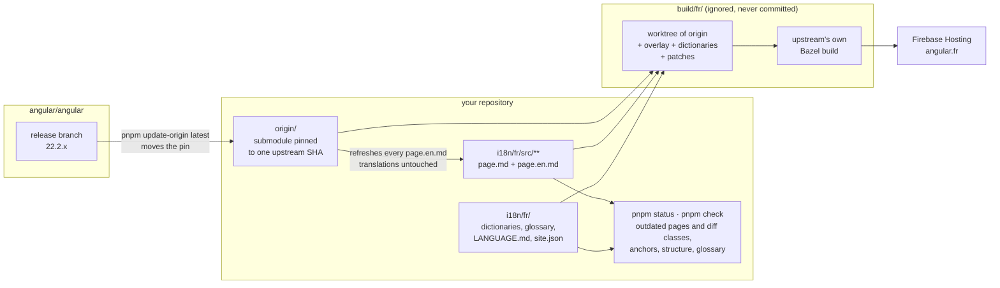

# angular-docs-rosetta

Translate and publish [angular.dev](https://angular.dev) in your language, and keep the translation current as upstream moves.

This is a **GitHub template repository**. Click **Use this template**, run one command, and you have a repo that builds a localized copy of the Angular docs site, tracks what changed upstream file by file, and ships with agent skills so humans and AI assistants translate and maintain it the same way.

**Start with [docs/guide.md](docs/guide.md)**: set up, deploy and maintain, end to end.

The model is the one proven by [angular.jp](https://github.com/angular/angular-ja) and [angular.lat](https://github.com/angular-hispano/angular-docs-es):

- `origin/` is `angular/angular` as a git submodule, pinned to the head of the latest release branch. Upstream files are never edited.
- `i18n/<lang>/src/**` mirrors `adev/src/**`. A translated `page.md` sits next to `page.en.md`, the English it was translated from, and starts with `<!-- source: <hash> -->`, the hash of that snapshot. The tooling knows exactly which pages are outdated and shows the English diff.
- The site is built in a throwaway directory: copy upstream, overlay the translations, apply string dictionaries and a few patches, run upstream's own Bazel build, deploy to Firebase Hosting. Nothing generated is committed.
- One repo can host several languages (`i18n/fr/`, `i18n/es/`, …): each language is its own build and its own Firebase site; the tooling, skills and upstream pin are shared.

In one picture (French as the example):



## Quick start (new language)

Requirements: Git, Node 26 (`.nvmrc`; `nvm use`, fnm or Volta) and pnpm (`npm install -g pnpm`; Node 25+ no longer ships corepack). One Node version is enough: the Angular build's Bazel toolchain downloads its own Node, and inside `build/<lang>` pnpm switches itself to the version upstream pins.

```bash
# 1. Create your repo from this template on GitHub, then:
git clone https://github.com/<you>/<your-repo>.git
cd <your-repo>
nvm use                # Node 26, from .nvmrc
pnpm install

# 2. Fetch the pinned upstream (shallow) and check your toolchain
pnpm bootstrap

# 3. Scaffold your language: i18n/<lang>/, dictionaries pre-filled with the English strings,
#    a LANGUAGE.md rules file, a seeded glossary, Firebase targets, CI matrix entry
pnpm create-language fr

# 4. See the work queue, translate, check, build
pnpm status fr
pnpm check fr
pnpm start fr          # dev server with live overlay (needs upstream's Node/pnpm, see pnpm bootstrap)
pnpm build fr          # production build, same targets as angular.dev
```

`i18n/<lang>/ONBOARDING.md` lists the GitHub and Firebase settings to flip before the first deploy. The step-by-step version is in [docs/guide.md](docs/guide.md). Contributors who only translate need none of the build: `pnpm install`, one `pnpm bootstrap` (shallow fetch of the pinned upstream, which `status`, `check` and `--init` read), `pnpm check`; a Codespace works out of the box (`.devcontainer/` runs those).

## Weekly loop (existing language)

```bash
pnpm update-origin latest   # move the pin to the head of the latest release branch, refresh every *.en.* snapshot
pnpm status fr --md         # outdated / new / removed files with diff classes: paste it into the sync PR
# translate the outdated passages (by hand, or with the adev-translation skill in Claude Code, Gemini CLI, Codex…)
pnpm check fr               # structure parity, anchors, glossary, typography, markers
```

Merging to `main` builds and deploys every language ([.github/workflows/deploy.yml](.github/workflows/deploy.yml)). A scheduled workflow opens the "Update origin" PR for you ([sync-upstream.yml](.github/workflows/sync-upstream.yml)).

## Repository layout

```
origin/                     git submodule: angular/angular at the pinned SHA (read-only)
i18n/<lang>/
  site.json                 domain, repo, Firebase targets, search, maintainers
  LANGUAGE.md               language rules: machine-checked front matter + prose for people and agents
  glossary.json             terms: keep in English, preferred rendering, forbidden renderings
  prh.yml, .textlintrc.json generated from glossary.json: textlint rules for `pnpm check` and editors
  dictionaries/             navigation.json, ui.json, index-html.json, pipeline.json (English string -> translation)
  src/**                    overlay of adev/src/**: page.md + page.en.md, app templates + .en.html
  README.md                 the language community: maintainers, chat, review rules
i18n/_example/              reference language used by the template's own CI (removed in your repo)
tools/                      the `rosetta` CLI (tools/cli.mjs): update-origin, status, check, build, start, create-language…
tools/adev-patches/         010 language switcher, notice and banners; 020 analytics only with your own GA4 id
.agents/skills/             adev-translation and adev-i18n-maintenance (Agent Skills format)
docs/                       guide (set up, deploy, maintain), translating, language rules, maintenance, search, architecture, adding a language
build/<lang>/               git worktree of origin + overlay (ignored, never committed)
```

## Commands

| Command | What it does |
| --- | --- |
| `pnpm bootstrap` | Initialize the `origin` submodule at the pinned SHA (shallow) and check Node/pnpm against upstream's requirements |
| `pnpm create-language <lang>` | Scaffold `i18n/<lang>/`, generate dictionaries from upstream, seed the glossary, wire CI and Firebase |
| `pnpm update-origin <sha\|branch\|latest>` | Move the pin, refresh every `*.en.*` snapshot, report new, removed and renamed upstream files |
| `pnpm status <lang> [--md\|--json]` | Per-file state: up to date, outdated (with diff class a/b/c/d), untranslated, removed, stale snapshot; dictionary gaps. `--init`, `--diff`, `--mark`, `--apply-mechanical` act on one page |
| `pnpm check <lang> [paths…] [--strict]` | Snapshot and marker present, line and structure parity, `{#english-anchor}` on headings and `docs-step` titles, alert keywords, glossary (textlint + prh), typography (warnings; errors with `--strict`); dead dictionary pairs |
| `pnpm dictionaries <lang> [--prune]` | Add new upstream strings to the four dictionaries (navigation, UI templates of the app and the shared docs components, `index.html` pairs, pipeline strings such as alert labels), English fallback; optionally drop obsolete keys |
| `pnpm glossary <lang> [--check]` | Regenerate the textlint rules (`prh.yml`, `.textlintrc.json`) from `glossary.json` |
| `pnpm start <lang>` | Dev server: build dir + overlay + ibazel, re-copies files as you edit |
| `pnpm build <lang>` | Production build, post-processing (edit links, sitemap, status report) |
| `pnpm report <lang>` | JSON status (coverage, freshness) consumed by the site and the status page |
| `pnpm firebase-config` | Regenerate `firebase.json` / `.firebaserc` from `i18n/*/site.json` and upstream's header rules |
| `pnpm search-index <lang> [--verify\|--reindex]` | Algolia crawler configuration for the site; test query with the search-only key; start a crawl after a deploy ([docs/search.md](docs/search.md)) |
| `pnpm languages [--matrix]` | List configured languages (used by the CI matrix) |
| `pnpm rosetta <command> --help` | Every command above is a subcommand of one CLI; `--help` lists its flags |
| `pnpm test` | The tooling's own test suite (unit, CLI end to end against a fixture upstream, anchor parity with upstream) |

## Languages in this repository

<!-- languages:start -->
| Language | Site | Maintainers |
| --- | --- | --- |
| Türkçe (`tr`) | https://angular-docs.tr |  |
<!-- languages:end -->

## Working with an AI assistant

The skills under `.agents/skills/` describe how to translate a page or a hunk (`adev-translation`) and how to run the repo (`adev-i18n-maintenance`). They are language-agnostic and start by reading `i18n/<lang>/LANGUAGE.md` and `glossary.json`. Point your assistant at `AGENTS.md`; Claude Code, Gemini CLI and Codex pick the skills up from there.

## Credits and license

Tooling: MIT, see [LICENSE](LICENSE). It adapts ideas and code from [angular/angular-ja](https://github.com/angular/angular-ja) and [angular-hispano/angular-docs-es](https://github.com/angular-hispano/angular-docs-es). The documentation you translate is the work of the Angular Team at Google and its contributors (MIT). A site built with this template is a community translation; say so on the site and follow Angular's [brand guidelines](https://angular.dev/press-kit).
