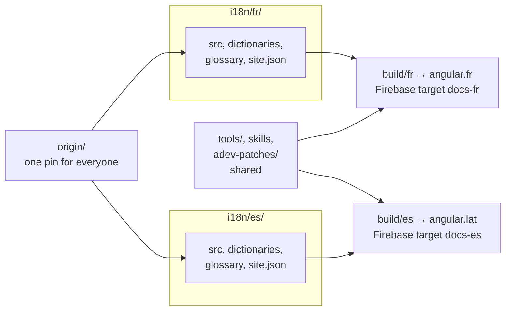

# Adding a second language to an existing repository

One repository can host several languages. They share the `origin` pin, the tooling, the skills and the patches; each language has its own folder, build, Firebase site and maintainers.



```bash
pnpm create-language es
```

What changes:

- `i18n/es/` is scaffolded exactly like the first language (see [getting-started.md](getting-started.md)).
- `languages.json` gains an entry; the CI matrix reads it, so `check`, `build` and `deploy` now run per language.
- `firebase.json` / `.firebaserc` gain a hosting target. All languages can live in one Firebase project with several sites, or in separate projects: set `firebase.projectId` and `firebase.target` per language in `site.json`.
- `CODEOWNERS` gains a line so the language's maintainers review `i18n/es/**`.

Things to agree on across languages:

- **Sync cadence.** `update-origin` moves the pin for everyone. The sync PR lists outdated files per language; a language that cannot keep up simply shows "outdated" banners on its pages. Decide who runs the weekly sync (one person, or the scheduled workflow).
- **Patches.** `tools/adev-patches/` is shared. A patch that needs language-specific values reads them from `site.json` at build time rather than hard-coding them.
- **Review.** Each language reviews its own translations; tooling changes are reviewed by the repository maintainers.

Removing a language: delete `i18n/<lang>/`, the entry in `languages.json`, the `CODEOWNERS` line and the Firebase target (`pnpm firebase-config` regenerates the config).
