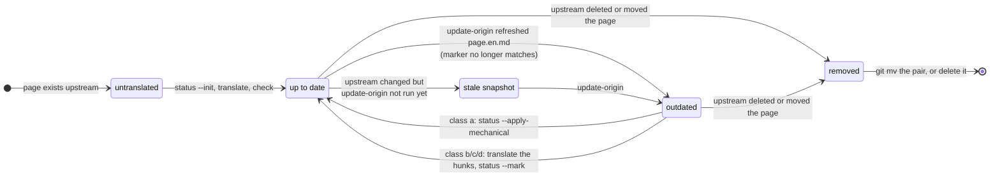
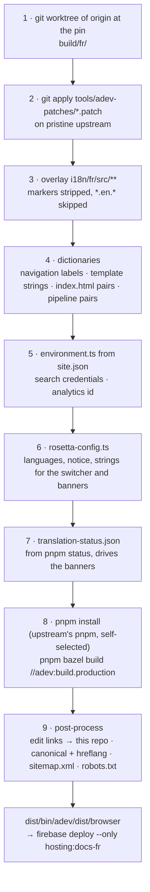

# Architecture

## The problem

angular.dev's content is 390-odd Markdown files (about 350,000 words) compiled to HTML at build time, plus an Angular app with English baked into templates and one large navigation file. Upstream touches 70 % of those files in six months. Any layout that edits upstream files in place conflicts on every sync, and a conflict between new English and old translation hides what actually changed.

## The layout

```
origin/                       angular/angular, git submodule, pinned SHA (head of the latest release branch)
i18n/<lang>/src/**            overlay of adev/src/**: page.md (+ marker) next to page.en.md (snapshot)
i18n/<lang>/dictionaries/     navigation.json, ui.json, index-html.json, pipeline.json
i18n/<lang>/LANGUAGE.md       rules (front matter machine-checked) and prose
i18n/<lang>/glossary.json     terminology
i18n/<lang>/site.json         domain, repo, Firebase, search, maintainers
tools/adev-patches/           code patches applied at build time (shared by all languages)
build/<lang>/                 git worktree of origin + overlay; node_modules; dist (ignored)
```

Upstream history is never merged or rebased: upstream code enters the build only by copy.

## The pin

The submodule pointer is the single baseline: one reviewed commit per sync says which upstream SHA every page is measured against. `pnpm update-origin` moves it to the head of the latest release branch (what angular.dev serves). `next` (upstream `main`) and previous versions are out of scope by design: one site, the current stable docs.

## Snapshots and markers

For each translated file `x.md`, `x.en.md` is the English it was translated from. The first line of `x.md` is `<!-- source: <hash> -->` with the git blob hash of the snapshot. Three consequences:

- `status` decides staleness without network or history: `hash(x.en.md) == marker` means up to date.
- The English the translator worked from is always recoverable: `git cat-file -p <hash>` prints the old snapshot even after `update-origin` overwrote the file, which is how `status --diff` shows the change.
- A sync PR shows `.en.md` and `.md` diffs side by side; reviewers never leave GitHub.

The cost is one duplicated English file per translated page (text, compressible, about 350,000 words at full coverage). angular-ja uses the same snapshots without the marker; angular-docs-es too. The marker is what lets banners and the status page compute staleness mechanically instead of by process.

Partial translations get a snapshot from the first line translated: a translated file without a snapshot is treated as untranslated by the next sync and overwritten. `check` refuses it.

The states `pnpm status` reports, and the commands that move a page between them:



## Dictionaries, overlays, patches

Three mechanisms, chosen per kind of change, from the most to the least tolerant of upstream churn:

| Mechanism | Used for | When upstream changes the source |
| --- | --- | --- |
| Dictionary (`English string -> translation`) | 306 navigation labels, 240-odd strings in 28 templates of the app and the shared docs components, `index.html` pairs, 15 pipeline pairs (alert labels, card and edit-link texts baked in by the Markdown pipeline) | New strings appear in English and are listed by `status`; a dead `find` pair fails `check` and the build until fixed |
| Full-file overlay (`i18n/<lang>/src/app/**` with `.en.*` snapshot) | Files upstream rarely edits: `versions.json`, `links.ts`, small templates | `update-origin` refreshes the snapshot and `status` flags the file |
| Patch (`tools/adev-patches/*.patch`) | Code-level changes: language switcher and banners (010), analytics opt-out (020) | `git apply --check` fails in CI; a maintainer refreshes the patch |
| Generated file (`environment.ts`, `rosetta-config.ts`) | Search credentials and analytics id from `site.json`; the build rewrites upstream's `environment.ts` and stops if its shape changed | A regular expression in `tools/lib/search.mjs` to update |

## The build

`pnpm build <lang>`, step by step (`--prepare-only` stops after step 7; `pnpm start` runs the same steps then `ibazel`):



In words:

1. `git -C origin worktree add build/<lang> <pin>` (or reset the existing worktree), so the build directory is a clean upstream checkout and `node_modules` survives between builds.
2. `git apply` each patch, on the pristine checkout: exactly what CI's `git apply --check` verifies. Patches come first because the dictionaries rewrite the very text their context lines contain.
3. Copy `i18n/<lang>/src/**` (minus `*.en.*`) over `build/<lang>/adev/src/**`. An overlay file replaces a patched file wholesale, so languages do not overlay the files the patches touch.
4. Apply dictionaries: `index.html` find/replace pairs (each must match), `label: '…'` replacements in `navigation-entries/index.ts`, exact text and attribute replacements per template (`adev/src/app/**` and `adev/shared-docs/components/**`), find/replace pairs in the pipeline sources under `adev/shared-docs/pipeline/` (alert labels and the like; each must match).
5. Rewrite `adev/src/app/environment.ts` from `site.json` (search credentials, analytics id).
6. Generate `adev/src/app/rosetta/rosetta-config.ts` (languages, notice, UI strings for the switcher and banners).
7. Write `adev/src/assets/others/translation-status.json` (the status report), so the site can show banners and a status page without a build-time dependency on the tooling. `--prepare-only` stops here.
8. `pnpm install --frozen-lockfile` and `pnpm bazel build //adev:build.production --config=release`, upstream's own targets. pnpm switches itself to the version upstream pins (`packageManager`), Bazel downloads the Node toolchain upstream pins (`MODULE.bazel`); the host runs Node 26 throughout.
9. Post-process the output: rewrite "edit on GitHub" links to this repo, add canonical and `hreflang` tags, generate `sitemap.xml` and `robots.txt`. (`pnpm firebase-config` copies upstream's `firebase.json` header rules into the repo-level Firebase config, separately.)

Headings: upstream generates anchors from heading text, so translated headings carry `{#english-id}`; the pipeline fails the build on in-page links to unknown anchors, which is a safety net, not the first line of defense (`check` is).

API reference, CLI reference and CDK/Aria reference are generated from code and JSON synced from other repos: they stay in English.

## Several languages

`i18n/<lang>/` is the unit. Languages share the pin, the tooling, the skills and the patches; each has its own build, Firebase site, domain, dictionaries, glossary and maintainers (diagram in [adding-a-language.md](adding-a-language.md)). The CI matrix is `languages.json`. Right-to-left languages need app patches (adev is not RTL-ready); CJK and other scripts need a font override through the `index-html` dictionary (`fonts` in `LANGUAGE.md`).

## Automation levels

0. Manual with the tooling. 1. A maintainer runs the sync locally and a local agent (Claude Code, Gemini CLI…) translates with the skill; no API cost. 2. The `sync-upstream` workflow opens the "Update origin" PR on a schedule; translation stays local. 3. On-demand AI in CI on the sync branch (your own key and budget). 4. Unattended for class-a changes only. Start at 1 + 2.

## Tooling

`tools/` is one Node CLI, `rosetta` (`tools/cli.mjs`, [citty](https://github.com/unjs/citty)); the `pnpm <name>` scripts are aliases of its subcommands and `pnpm rosetta <command> --help` documents the flags. Subcommands live in `tools/commands/`, shared code in `tools/lib/`, tests in `tools/test/`. The custom code is the Rosetta-specific logic (snapshots and markers, diff classes, overlay and build steps); everything that has a maintained equivalent is a dependency:

| Concern | Library | Why |
| --- | --- | --- |
| Argument parsing, help, subcommands | citty | lazy-loaded subcommands, generated `--help`, enum and positional validation |
| Processes (git, pnpm, bazel) | execa | errors carry the command and stderr; output streamed or captured (final newline kept: `git cat-file` output must round-trip) |
| `site.json` validation | ajv (draft 2020) | one schema, `tools/site.schema.json` (part of the tooling, so template sync keeps it current), for the tooling and for editors |
| Language tags and names | bcp-47 + `Intl.DisplayNames` / `Intl.Locale` | `pt-BR`, `zh-Hans` parsed; native and English names and text direction from ICU, no hand-written table |
| Line diffs, diff classes, unified output | diff (jsdiff) | `diffArrays` over `split('\n')`, so a trailing newline is a line like everywhere else in the tooling |
| Markdown structure (headings, `docs-*` elements, code blocks, links) | marked | the parser adev's own pipeline uses, so `check` sees the same tokens as the build; `getIdFromHeading` stays a port and `tools/test/parity.test.mjs` compares it with upstream's implementation (loaded through jiti) |
| Angular templates (UI dictionaries) | angular-html-parser | the parser Prettier uses for Angular templates; strings and attributes are located by source span and replaced in place, nothing else in the template moves |
| Glossary enforcement | textlint + textlint-rule-prh | angular-ja's setup; `glossary.json` → `prh.yml` + `.textlintrc.json`, shared by `check`, CI and editors |
| Interactive scaffolding | @clack/prompts | `create-language` prompts; `--yes` and flags for scripts and CI |
| Watching, globbing, YAML, colors | chokidar, tinyglobby, yaml, picocolors | small, maintained, common in the Angular ecosystem |

Tests (`pnpm test`, `node:test`): unit tests per library module, a `package.json` scripts test (no alias may reuse a pnpm command name), an end-to-end file that runs the CLI as a child process through a whole maintainer session (scaffold → translate → check → sync → mechanical apply → dictionaries → report → `build --prepare-only`), and a parity test that loads upstream's `heading.mts` through jiti. Everything runs against temporary repositories built from `tools/test/fixtures/upstream`, a pocket-size `angular/angular` (content pages with headings, steps, alerts and code, navigation entries, templates with `@if`/`@let`, shared docs components, pipeline sources, `index.html`, `firebase.json`); `ROSETTA_ROOT` and `ROSETTA_ORIGIN` point the tooling at them, so no test writes into the checkout. Only the Bazel build itself is out of reach of the suite; the template's canary workflow builds `i18n/_example` for real.

## Prior art

angular-ja (origin submodule, `.en.md` snapshots, patches, Gemini-assisted translation behind textlint, skills), angular-docs-es (same model, 93 % coverage), Vue's Ryu-Cho and React's sync bot (detection only), MDN's `l10n.sourceCommit` (per-file source marker), Lunaria (status dashboard). This template borrows from all of them; see the PRD linked from the repository description.
