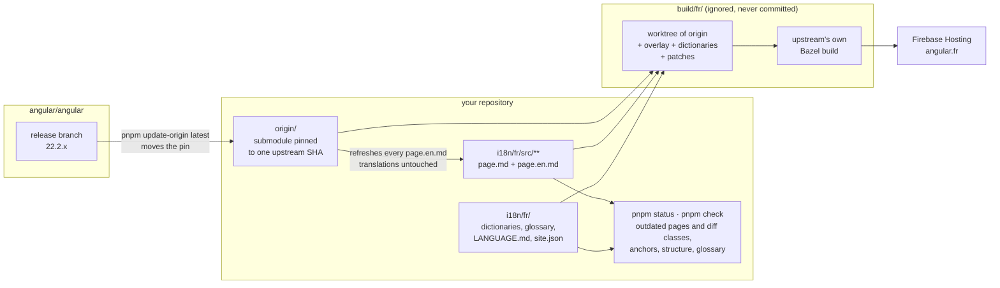
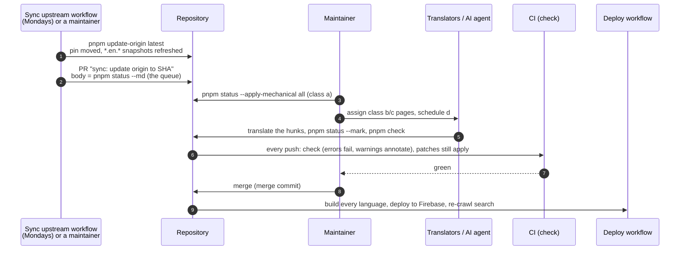

# The guide: set up, deploy, maintain

Everything a maintainer needs, in order. Deep dives are linked where they exist; this page is enough on its own.

- [Part 1 — Set up a translated site](#part-1--set-up-a-translated-site) (about 30 minutes plus one build)
- [Part 2 — Deploy](#part-2--deploy)
- [Part 3 — Maintain the translation](#part-3--maintain-the-translation) (about an hour a week)
- [Troubleshooting](#troubleshooting)

## How it works, in five lines

1. `origin/` is `angular/angular` as a git submodule, pinned to the head of the latest release branch. Upstream files are never edited.
2. `i18n/<lang>/src/**` mirrors `adev/src/**`. A translated `page.md` sits next to `page.en.md`, the English it was translated from, and starts with `<!-- source: <hash> -->`, the git hash of that snapshot.
3. `pnpm status` compares hashes: it knows which pages are up to date, outdated (with the English diff and a size class), untranslated or removed upstream.
4. `pnpm build` copies upstream into `build/<lang>/`, overlays the translations, applies string dictionaries and two small patches, runs upstream's own Bazel build, then writes the sitemap and SEO tags.
5. Firebase Hosting serves the result; CI builds on every merge and a scheduled job opens the weekly "update origin" PR.



---

## Part 1 — Set up a translated site

### 1.1 Prerequisites

| Tool | Version | Why |
| --- | --- | --- |
| Git | 2.30+ | submodule, worktrees |
| Node | 26 (`.nvmrc`) | tooling, CI and devcontainer; the Angular build's Bazel toolchain downloads its own Node (upstream's `MODULE.bazel`), so no second Node is needed |
| pnpm | 10.x (`packageManager`), `npm install -g pnpm` | Node 25+ no longer ships corepack; inside `build/<lang>` pnpm switches itself to the version upstream pins (11.x today) |
| Disk | 5+ GB per language | `build/<lang>` holds `node_modules` and Bazel outputs |

Install Node with a version manager (`nvm`, `fnm`, Volta) that reads `.nvmrc`.

### 1.2 Create the repository

1. On GitHub: open `openng-org/angular-docs-rosetta` → **Use this template** → **Create a new repository**. Public; default branch only. Name it after the site, for example `angular-docs-fr`.
2. In the new repository's settings: enable **Actions** (Settings → Actions → Allow all actions), and under **General → Pull Requests** allow "Allow GitHub Actions to create and approve pull requests" (needed by the sync and cleanup workflows).

```bash
git clone https://github.com/<org>/<repo>.git
cd <repo>
nvm use                   # Node 26, from .nvmrc
pnpm install
pnpm bootstrap            # fetches the pinned upstream commit (shallow) into origin/, reports Node, pnpm and Bazel's own Node
```

### 1.3 Scaffold the language

```bash
pnpm create-language fr
```

Answer the prompts (language name, direction, register, domain, GitHub repo, Firebase project and target, maintainers). The command creates `i18n/fr/`:

| File | What to do with it |
| --- | --- |
| `site.json` | Fill `domain`, `firebase`, `community`; translate `notice` and the `strings` block (switcher and banner texts) |
| `LANGUAGE.md` | The rules. For French it is pre-filled, and the example's translated pages (with their snapshots) are copied into `src/` as a reference for tone and typography; for other languages fill the TODOs (see [language-rules.md](language-rules.md)) |
| `glossary.json` | Seeded with the most frequent technical terms; give each a translation or `keep: true`, list wrong renderings under `forbidden` |
| `prh.yml`, `.textlintrc.json` | Generated from the glossary (`pnpm glossary fr`): the forbidden renderings as [textlint](https://textlint.org) rules, used by `pnpm check` and by the textlint extension of your editor |
| `dictionaries/navigation.json`, `ui.json` | Every English string of the navigation, the app templates and the shared docs components (search dialog, table of contents, cookie banner, example viewer…); translate the values |
| `dictionaries/index-html.json` | `lang`, title, description and URLs of the HTML shell; translate the title and description pairs |
| `dictionaries/pipeline.json` | Strings the docs pipeline bakes into every page: alert labels (`NOTE:`, `TIP:`…), "Learn more" on cards, the edit-page tooltip, prefer/avoid headers; find/replace pairs per upstream file, translate the quoted text in `replace` |
| `README.md`, `ONBOARDING.md` | Community page and the settings checklist |

It also registers the language in `languages.json`, `CODEOWNERS` and the README table, generates `firebase.json` / `.firebaserc`, and offers to delete the template's example language. Commit:

```bash
pnpm check fr
git add -A && git commit -m "i18n(fr): scaffold language" && git push
```

### 1.4 Translate the chrome first

The navigation, footer, home page and HTML metadata are dictionaries, not Markdown. Translate the values in `i18n/fr/dictionaries/*.json` and `strings` in `site.json`, run `pnpm check fr`, commit. From now on every deploy has a fully localized shell even while pages are still English, and untranslated pages show a banner saying so.

### 1.5 First pages

```bash
pnpm status fr                                              # queue: untranslated pages, dictionary gaps
pnpm status fr --init content/guide/signals/overview.md     # a page listed as untranslated (for French, the introduction already comes from the example)
# translate i18n/fr/src/content/guide/signals/overview.md in place (--init already set the marker)
pnpm check fr i18n/fr/src/content/guide/signals/overview.md
```

Rules the checker enforces (details in [translating.md](translating.md)): same line count as the snapshot, every heading and `docs-step` title keeps its English anchor (`## Composants {#components}`, `title="Créer un composant {#create-a-component}"`), same `docs-*` elements, code blocks and links, glossary and typography from `LANGUAGE.md`. Suggested order: introduction and essentials, guide (components, templates, signals, DI, routing, forms, HTTP, SSR), tutorials, best practices, tools, ecosystem, reference pages.

With an AI assistant: open the repo in Claude Code, Gemini CLI or another skills-aware agent, point it at `AGENTS.md`, and ask it to translate a page; the `adev-translation` skill applies the same rules and runs `pnpm check`.

### 1.6 Preview locally

```bash
pnpm start fr         # build/fr worktree + patches + overlay + dictionaries + ibazel dev server; edits under i18n/fr/src are live
```

The first start installs upstream's dependencies and compiles the framework: 10 to 20 minutes. Later starts are fast. `pnpm build fr` produces the production output in `build/fr/dist/bin/adev/dist/browser`.

---

## Part 2 — Deploy

### 2.1 Firebase

1. Create a Firebase project (or reuse one), enable **Hosting**.
2. Create a hosting site per language (Hosting → Add another site), or use the project's default site for a single language.
3. Map the target named in `site.json` to the site: `firebase target:apply hosting docs-fr <site-id>` — or set `firebase.site` in `site.json` and run `pnpm firebase-config`, which regenerates `firebase.json` and `.firebaserc` with upstream's header rules (the tutorials' WebContainers need the `Cross-Origin-*` headers; never deploy without them).
4. Connect the custom domain (Hosting → Add custom domain) and set the DNS records it asks for.

### 2.2 GitHub secrets and protection

| Setting | Value |
| --- | --- |
| Secret `FIREBASE_SERVICE_ACCOUNT` | JSON key of a service account with the **Firebase Hosting Admin** role on the project (Google Cloud Console → IAM → Service accounts → Keys) |
| Branch protection on `main` | Require a pull request; require the `Check <lang>` status |
| Environment `production` | Created automatically by the deploy workflow; add required reviewers there if you want a manual gate |
| Secret `SYNC_TOKEN` (recommended) | A fine-grained personal access token (or a GitHub App token) with *contents: write*, *pull requests: write* and *workflows: write* on this repository. The scheduled **Sync upstream** workflow opens its PR with it (a PR opened with the default `GITHUB_TOKEN` does not trigger the `Check` workflow, so without this secret the sync PR shows no CI until someone pushes to it), and the **Template sync** workflow pushes the template's updates with it (the default token is refused as soon as a file under `.github/workflows` changes, which most template updates do) |
| Secrets `ALGOLIA_CRAWLER_USER_ID`, `ALGOLIA_CRAWLER_API_KEY` (optional) | Crawler credentials, once the site has its own search index ([search.md](search.md)) |

### 2.3 First deploy

Push to `main` (or run **Deploy** manually from the Actions tab). The workflow builds each language on a free runner (15 to 40 minutes, cached after the first run) and runs `firebase deploy --only hosting:<target>`. Manual alternative from a maintainer's machine:

```bash
pnpm build fr
npx firebase-tools@14 deploy --only hosting:docs-fr --project <project-id>
```

### 2.4 Verify

- `https://<domain>/` opens with `lang="fr"` and the translated title (view source).
- A translated page shows no banner; an untranslated one shows the "shown in English" banner; the footer shows the language switcher and the community notice.
- A tutorial step runs (WebContainers → headers are right).
- `https://<domain>/sitemap.xml` and `/assets/others/translation-status.json` respond.
- The search box works from day one against upstream's English index (hits open your translated pages). Searching in your language needs an index of your own: apply to Algolia's DocSearch program now that the site is live, then follow [search.md](search.md) (crawler configuration from `pnpm search-index fr`, credentials in `site.json`, `pnpm search-index fr --verify`).
- Analytics: nothing is sent anywhere unless `site.json` → `analytics` names your own GA4 id ([search.md](search.md#analytics-the-same-way)).

Rollback: Firebase console → Hosting → Release history → Rollback, or re-run Deploy from an older commit.

---

## Part 3 — Maintain the translation

### 3.1 The weekly loop

The scheduled **Sync upstream** workflow (Mondays) moves the pin to the head of the latest release branch, refreshes every `*.en.*` snapshot and opens a PR named `sync: update origin to <sha>` whose body is the per-language queue. Who does what, in order:



Doing steps 1 and 2 by hand is the same:

```bash
pnpm update-origin latest
pnpm status fr --md > /tmp/status.md          # the queue: outdated pages with diff classes, new and removed pages, new UI strings
git switch -c sync/$(git -C origin rev-parse --short HEAD)
git add origin i18n && git commit -m "sync: update origin to $(git -C origin rev-parse --short HEAD)"
```

Then, on that branch:

| Class | Meaning | Do |
| --- | --- | --- |
| a | code, links, whitespace only | `pnpm status fr --apply-mechanical all` |
| b | ≤ 5 prose lines | `pnpm status fr --diff <page>`, translate the hunks, `pnpm status fr --mark <page>` |
| c | ≤ 30 prose lines | same, read the whole page once |
| d | restructure | retranslate the page, or keep the new English section in place and list it under "Untranslated or deferred" |
| new pages | | `pnpm status fr --init <page>` when short and in a priority area; otherwise open a `type:translation` issue |
| removed / renamed | | `git mv` both files of the pair, or delete them |

New navigation labels and UI strings: `pnpm dictionaries fr` adds them with English values; translate, commit. Finish with `pnpm check fr`, push, open the PR from the template (sections "Untranslated or deferred" and "Removed or moved" are mandatory), merge with a **merge commit**. The deploy workflow ships it.

Readers never see a half state: an outdated page keeps its translation and gets a banner; an untranslated page shows the English with a banner; the status JSON and the per-page markers drive both.

### 3.2 Minor and major releases

`pnpm update-origin latest` follows angular.dev to the new release branch automatically. Expect more snapshot refreshes, new navigation entries (`pnpm dictionaries fr`), and possibly moved pages (the command prints renames). Build once locally before merging; a major may change the docs pipeline, which is a reason to stop and read upstream's changes, not to patch around them. Previous versions are not served, by design.

### 3.3 Dictionaries and `index.html` pairs

`pnpm check` fails when an `index-html.json` pair no longer matches upstream's `index.html` (the page would ship with `lang="en"`) or a `pipeline.json` pair no longer matches its upstream file (the alert labels would ship in English): open the upstream file (`origin/adev/src/index.html`, `origin/adev/shared-docs/pipeline/…`), fix the `find` text, keep your `replace`. `pnpm dictionaries fr` adds the pairs of new upstream strings and reports the dead ones. Obsolete navigation or UI keys are reported; `pnpm dictionaries fr --prune` drops them.

### 3.4 Patches

`tools/adev-patches/010-rosetta-ui.patch` adds the language switcher (footer), the community notice and the per-page banners. It touches four upstream lines; when upstream changes them CI's `git apply --check` fails:

```bash
pnpm build fr --prepare-only          # stops at the dead patch
cd build/fr
git checkout -q -- adev && git clean -fdq adev          # pristine upstream: drop the overlay, dictionaries and generated files first
git apply --3way ../../tools/adev-patches/010-rosetta-ui.patch
# resolve the conflict markers, then regenerate that patch alone:
git add -A adev && git diff --cached > ../../tools/adev-patches/010-rosetta-ui.patch
cd ../.. && pnpm build fr --prepare-only   # must pass again
```

For a patch that is not the first one, or a new patch, follow the recipe in [maintenance.md](maintenance.md#patches) (the earlier patches are committed as a baseline first).

`pnpm build fr --skip-patches` builds without them if you need a deploy before the fix. Patch strings come from `site.json` (`notice`, `strings`), generated into `adev/src/app/rosetta/rosetta-config.ts` at build time.

### 3.5 Contributors and agents

- `CONTRIBUTING.md` and [translating.md](translating.md) are the contributor path: translating needs `pnpm install`, one `pnpm bootstrap` (shallow fetch of the pinned upstream) and `pnpm check`, no build.
- Labels `type:translation`, `type:sync`, `type:tooling`, `type:template-sync` (reserved for the template-sync PR, which closes the previous one by that label), `build` (forces the full Bazel build on a PR), `good first translation`; the issue form "Translation request / claim" avoids two people on one page.
- `.agents/skills/adev-translation` and `adev-i18n-maintenance` encode this guide for AI assistants; `AGENTS.md` points at them. Keep `LANGUAGE.md` and `glossary.json` current: they are what the skill reads.
- The template's tooling evolves: the **Template sync** workflow opens a PR when `tools/`, skills, workflows or docs change upstream in the template; `i18n/`, `languages.json`, the Firebase config, `CODEOWNERS`, the README, `origin` and `.gitmodules` are never touched (`.templatesyncignore`). The PR needs `SYNC_TOKEN` when it changes workflows (most do).

### 3.6 Health signals

- `pnpm report fr --summary`: coverage, outdated pages, median and maximum staleness, pages over 30 days.
- CI step summaries show the status report on every PR.
- `/assets/others/translation-status.json` on the live site is what the banners read; it doubles as a public status endpoint.

---

## Troubleshooting

| Symptom | Cause | Fix |
| --- | --- | --- |
| `pnpm bootstrap`: "No `origin` gitlink" | The submodule pointer was never committed | `pnpm update-origin latest`, commit `origin` and `.gitmodules` |
| `pnpm bootstrap` is slow | Full fetch | The default fetch is shallow; a slow network still downloads ~200 MB once |
| `pnpm build` fails with a Node version error | Upstream's Node differs from yours | `nvm use $(cat origin/.nvmrc)` |
| `pnpm build`: "patch no longer applies" | Upstream changed a patched file | §3.4, or `--skip-patches` |
| `pnpm build`: "index.html pair no longer matches" | Upstream changed `index.html` | §3.3 |
| `pnpm check`: "line count differs" | Lines merged or split in the translation | Match the snapshot's line breaks; `lineParity: warn` in `LANGUAGE.md` relaxes it |
| `pnpm check`: "heading anchor must be …" | Translated heading without `{#english-id}` | Add the suggested `{#id}` (also inside `docs-step` titles) |
| `pnpm status`: page listed as "stale snapshot" | `update-origin` not run, or sync commit incomplete | `pnpm update-origin` then commit `i18n` |
| `pnpm status --diff`: "snapshot … is not in this repository's history" | The old English was never committed | Commit translations together with their snapshots; apply the diff by hand this once |
| Banner says "not translated" on a translated page | Marker missing or page key mismatch | `pnpm status fr --mark <page>`; keys are `guide/x/y` without extension |
| Tutorials do not start on the live site | Hosting without the `Cross-Origin-*` headers | Deploy with the generated `firebase.json` (`pnpm firebase-config`) |
| Bazel out of memory in CI | Free runner limits | The workflows already pass `--local_resources=memory=4096 --jobs=1`; try `max-parallel: 1` |
| Submodule errors for a contributor | They cloned without initializing it | `pnpm bootstrap` fetches it shallowly (one download); `status`, `check` and `--init` need it, the build is what they can skip |
