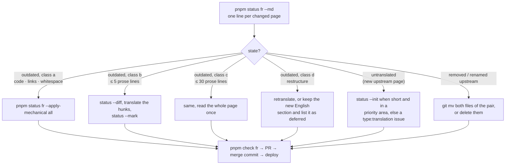

# Maintenance: keeping the site current

This is the human version of the `adev-i18n-maintenance` skill. One maintainer, about an hour a week.

## The weekly sync

```bash
pnpm update-origin latest        # or a branch (22.2.x) or an exact SHA
pnpm status <lang> --md > /tmp/status.md
git switch -c sync/$(git -C origin rev-parse --short HEAD)
git add origin i18n
git commit -m "sync: update origin to $(git -C origin rev-parse --short HEAD)"
```

`update-origin`:

1. resolves the target (`latest` = head of the highest `NN.N.x` branch on `angular/angular`), fetches it shallowly into `origin/` and checks it out detached; the parent repo's gitlink is staged;
2. overwrites every `*.en.*` snapshot whose upstream file changed (your translations are untouched);
3. reports upstream files that were removed or renamed since the previous pin, so you can move or delete the matching pairs;
4. prints the per-language summary.

Open the PR with the status report as body: it is the work queue. Translate (or let translators and agents pick items), `pnpm check`, merge with a merge commit. The `sync-upstream` workflow does steps 1 to 4 on a schedule and opens the PR for you; the `deploy` workflow builds and deploys on merge.

## Diff classes and triage



`status` classifies each outdated file: **a** code, link targets, URLs or whitespace only; **b** up to 5 changed prose lines; **c** up to 30; **d** restructure. Class a is applied by `pnpm status <lang> --apply-mechanical all` (it swaps the changed code lines and link targets into the translation and updates the markers); do b next (minutes), batch c, schedule d. Pages under `reference/errors/` and `roadmap.md` change constantly: batch them monthly unless a change is user-facing.

## New minor or major release

angular.dev switches to the new release branch on release day; so do you:

```bash
pnpm update-origin 22.3.x
```

Then re-check the full-file overlays that track upstream app code (`versions.json`, `links.ts`, anything under `i18n/<lang>/src/app/**`), run `pnpm dictionaries <lang>` to pick up new navigation labels and UI strings, and `pnpm build <lang>` once locally before merging. Major releases usually move or rename pages: `update-origin` prints the renames it detects.

## Dictionaries

Navigation labels, UI strings and `index.html` metadata are not Markdown. `pnpm dictionaries <lang>` adds every new upstream string with its English value (so the site never breaks) and lists them; translate the values and commit. `--prune` removes keys upstream no longer has. `pnpm check` fails when an `index-html` pair no longer matches upstream (the page would ship with the wrong `lang`); fix the pair.

## Patches

`tools/adev-patches/010-rosetta-ui.patch` carries the code-level changes: the footer language switcher with the community notice, and the per-page outdated/untranslated banners (texts from `site.json` → `notice` and `strings`, generated into `adev/src/app/rosetta/rosetta-config.ts` at build time). `020-optional-analytics.patch` keeps Google Analytics off unless `site.json` names your own id. Patches are applied with `git apply` in the build directory and verified by `git apply --check` in CI on every PR. When upstream changes a patched file:

```bash
pnpm build <lang> --prepare-only          # worktree, then patches on pristine upstream: stops at the dead one and names it
cd build/<lang>
git checkout -q -- adev && git clean -fdq adev   # back to pristine upstream: drops the overlay, the dictionaries, environment.ts, rosetta-config.ts and the patches that did apply
# the patches that come before the dead one, applied and committed as a baseline (skip when the dead one is 010):
git apply ../../tools/adev-patches/010-rosetta-ui.patch && git add -A adev && git commit -qm baseline
git apply --3way ../../tools/adev-patches/020-optional-analytics.patch   # the dead one
# resolve the conflict markers in the listed files (usually an import line or the imports array moved), then:
git add -A adev && git diff --cached > ../../tools/adev-patches/020-optional-analytics.patch
cd ../.. && pnpm build <lang> --prepare-only   # resets the worktree (the baseline commit is discarded) and applies everything again: must pass
```

The reset matters: without it the regenerated patch would carry the translated labels, the UI strings and the generated `environment.ts` and `rosetta-config.ts`. [tools/adev-patches/README.md](../tools/adev-patches/README.md) has the recipe for a new patch.

`pnpm build <lang> --skip-patches` ships without switcher and banners when a fix cannot wait. Keep patches to a handful; anything that can be a dictionary entry or an overlay file should be one.

## Build, deploy, rollback

- `pnpm build <lang>`: git worktree of `origin` under `build/<lang>/`, patches (on pristine upstream), overlay, dictionaries, generated files, `pnpm install --frozen-lockfile`, `pnpm bazel build //adev:build.production --config=release`, then post-processing (edit links, sitemap, status report). Output: `build/<lang>/dist/bin/adev/dist/browser`.
- Toolchain: Node 26 for everything (`.nvmrc`). Inside `build/<lang>` pnpm switches itself to upstream's pinned version (`packageManager`), and Bazel downloads the Node toolchain upstream pins (`MODULE.bazel`); the host Node only runs pnpm and bazelisk. `origin/.nvmrc` is the fallback if upstream's `pnpm install` ever refuses the host Node.
- CI recipe (from angular-docs-es): free `ubuntu-latest` runner, `bazel-contrib/setup-bazel` with caches, `--local_resources=memory=4096 --jobs=1`, `--sandbox_default_allow_network` for the Algolia prerender, `NODE_OPTIONS=--max-old-space-size=4096`. Expect 15 to 40 minutes.
- Deploy: `firebase deploy --only hosting:<target> --project <id>` with the service account in `FIREBASE_SERVICE_ACCOUNT`. Rollback: Firebase Hosting > Release history > Rollback, or redeploy the previous `main` commit.

## When to stop and ask

A patch that no longer applies, an `index-html` pair that no longer matches, a build failure after upstream changed `adev/shared-docs/pipeline` or `adev/BUILD.bazel`, or a page that would ship half-translated outside the deferred list. These are maintainer decisions, not things to force through.

## Search index

A site with its own Algolia index (see [search.md](search.md)) is re-crawled by the deploy workflow when `search.crawlerId` and the two Crawler secrets are set; otherwise schedule a weekly crawl in the Algolia dashboard and start one by hand after a release switch. Pages translated between two crawls are found through their English text only until the next crawl.
