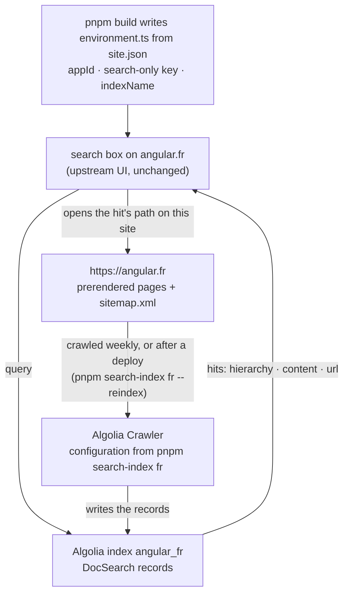

# Search: giving the translated site its own index

angular.dev's search is Algolia. The search box, the results dialog and the "Search by Algolia" line are upstream code, untouched by this template; what a translation needs is **an index of its own pages**, so that readers can search in their language and land on translated pages. This page covers how upstream's search works, the three ways to run it on a translated site, the Algolia setup step by step, and how to keep the index fresh.

## How adev searches

- The client is `algoliasearch/lite`, created in `adev/src/app/app.config.ts` from `adev/src/app/environment.ts`, a plain object: `algolia.appId`, `algolia.apiKey` (a **search-only** key, public by design: it ships in the bundle) and `algolia.indexName` (`angular_v<major>`, or `angular_next_dev` for pre-releases).
- `adev/shared-docs/services/search.service.ts` queries that index and expects **DocSearch records**: `hierarchy.lvl0` … `lvl6`, `content`, `type`, `url`. It switches on `lvl0`: `Tutorials` gets the code icon, `Reference` gets a package badge; everything else is a doc page.
- A hit navigates to the **path** of the record's URL on the current site (`relativeLink` pipe). Routes are identical on every Rosetta site, so a record crawled on `https://angular.fr/guide/signals` or on `https://angular.dev/guide/signals` both open `/guide/signals` on the site you are on.
- The index behind angular.dev is filled by the Algolia Crawler from angular.dev itself, in English.

`pnpm build` rewrites `environment.ts` from `i18n/<lang>/site.json` (`tools/lib/search.mjs`, `environmentSource`) before the Bazel build, and refuses to build if upstream changed the file's shape. Nothing else in the app changes.

With an index of your own, the pieces fit like this:



## Three ways to run search

| `site.json` → `search.provider` | What readers get | When |
| --- | --- | --- |
| `none` (default after `pnpm create-language`) | Upstream's English index with your site's search-only client. Queries match **English** words only; hits open the translated page of the same route (or the English page when it is not translated yet, with the banner). | Day one: nothing to set up. Also the fallback if your own index is ever unavailable. |
| `docsearch` | Your own index, crawled from your live site, through Algolia's free [DocSearch program](https://docsearch.algolia.com/docs/docsearch-program). Queries match your language. | Recommended once the site is live. |
| `algolia` | Same, on an Algolia application you own (Free plan or paid). | When DocSearch declines the site, when you need more than its record cap, or when you already have an Algolia account. |

Both `docsearch` and `algolia` use the same crawler configuration and the same `site.json` fields; only who pays and who owns the application differ.

Note on the fallback: Angular's search-only key currently answers requests from any origin. Algolia keys can be restricted by HTTP referrer at any time; if search on your site suddenly returns errors while `provider` is `none`, that is the moment to set up your own index.

## Setting up DocSearch (recommended)

Prerequisites: the site is **deployed and public** (the crawler fetches it; apply after the first deploy), the repository is open source, and the "Search by Algolia" line in the results dialog stays (it is upstream's; keep it, the program requires it).

1. **Apply.** Sign in to the [Algolia dashboard](https://dashboard.algolia.com/) and start the DocSearch onboarding; submit `https://<your domain>`. Validation is automated; a manual review takes one to two business days when it cannot decide. You must verify ownership of the domain within 7 days of approval (a DNS record or a meta tag, as the dashboard instructs). Community translations of technical documentation are the program's intended audience; applications are declined for sites that are not production-ready or that carry non-technical content.
2. **Collect the credentials.** The acceptance gives you an Algolia **application id**, a **search-only API key** and an **index name**, plus a crawler of your own in the dashboard (Data sources → Crawler). Only the search-only key goes into the repository.
3. **Replace the crawler configuration** with the one the tooling generates for your site:

   ```bash
   pnpm search-index fr > crawler.config.js      # or: pnpm search-index fr --out crawler.config.js
   ```

   Open the crawler in the dashboard → Editor, paste the file, keep the `appId` and `apiKey` the editor already shows (the crawler's own write key, never the search-only one), check that `indexName` matches the index you were given, save. The generated configuration:
   - crawls `https://<domain>/` from the `sitemap.xml` that `pnpm build` writes, following links under the domain only;
   - **excludes** `/api/**` and `/cli/**` (the API and CLI references stay in English and are large; search them on angular.dev), the playground, the update guide and assets;
   - produces DocSearch v3 records with `lvl0` = `Docs`, `Tutorials` or `Reference` (adev switches on these values), `lvl1` = the page `<h1>`, `lvl2`…`lvl5` = `<h2>`…`<h5>`, `content` = paragraphs, list items and table cells, one record per heading (`aggregateContent: true`);
   - keeps `renderJavaScript: false` because the pages are prerendered; set it to `true` only if a test crawl produces empty records.
4. **Run a crawl** from the dashboard (Overview → Start crawl) and look at the record count and the URL report. The free program caps an index at **10,000 records**; expect roughly 10 to 30 records per page with the default configuration, so the translated docs fit with the reference sections excluded. If you hit the cap, add paths to `exclusionPatterns` (for example `/reference/errors/**` while it is untranslated) or lower `maxDepth`.
5. **Wire the site.** In `i18n/fr/site.json`:

   ```json
   "search": {
     "provider": "docsearch",
     "appId": "ABCDEFGHIJ",
     "apiKey": "search-only-key",
     "indexName": "angular_fr",
     "crawlerId": "e0f6db8a-24f5-4092-83a4-1b2c6cb6d809"
   }
   ```

   `crawlerId` is optional: it is the UUID in the crawler's dashboard URL and lets the deploy workflow re-crawl after each release (below). `pnpm check fr` validates the block (`appId`, `apiKey` and `indexName` are required as soon as `provider` is not `none`).
6. **Verify** before committing:

   ```bash
   pnpm search-index fr --verify              # runs a query with the search-only key
   pnpm search-index fr --verify --query "injection de dépendances"
   ```

   The command reports the hit count, the first results (`lvl0 › lvl1  url`) and the three usual problems: wrong credentials (HTTP 401/403), empty index (the crawl did not run or the sitemap was unreachable), records that are not DocSearch records (another configuration was used).
7. **Commit and deploy.** The next `pnpm build` writes your credentials into `environment.ts`; the search box now searches your index. Keep the "Search by Algolia" line.

## Own Algolia application

Create an application in the [Algolia dashboard](https://dashboard.algolia.com/) (the Free plan includes 10,000 search requests, 50,000 records and 5,000 crawls per month as of August 2026, no card; check the [pricing page](https://www.algolia.com/pricing/free-plan) for current figures), then: Data sources → Crawler → create a crawler for `https://<domain>/`, paste the configuration from `pnpm search-index <lang>` (the editor holds the crawler's write key; `indexName` is yours to choose, `angular_<lang>` is the convention), crawl, and take a **search-only** key from Settings → API keys for `site.json` with `"provider": "algolia"`. Steps 5 to 7 above are identical. Monthly search requests are the figure to watch on the Free plan: every keystroke after the 200 ms debounce is a request.

## Keeping the index fresh

A crawl is a snapshot of the site; pages translated after it are found only in English (through their untranslated English text) until the next one.

- **Schedule** a crawl in the dashboard (weekly is plenty for a docs site).
- **After each deploy**: the deploy workflow runs `pnpm search-index <lang> --reindex`, which starts a crawl through the [Crawler API](https://www.algolia.com/doc/rest-api/crawler/start-reindex) when `search.crawlerId` is set and the repository has the secrets `ALGOLIA_CRAWLER_USER_ID` and `ALGOLIA_CRAWLER_API_KEY` (Crawler dashboard → Settings; these are Crawler credentials, distinct from the search keys, and never go into `site.json`). Without the id or the secrets the step is a no-op. Locally: `ALGOLIA_CRAWLER_USER_ID=… ALGOLIA_CRAWLER_API_KEY=… pnpm search-index fr --reindex`.
- **Release switch** (`pnpm update-origin` to a new major): your index name does not change with the Angular version (upstream renames theirs every major, you do not have to), but the pages do; re-crawl after the deploy.
- **Synonyms**: upstream maintains a list (`adev/scripts/synonyms`) uploaded with an admin key. Add yours from the dashboard (Index → Configuration → Synonyms): `DI` ↔ `injection de dépendances`, `template` ↔ `gabarit` if readers type it, English terms readers may use for a French page.

## Several languages

One index per language: each `i18n/<lang>/site.json` carries its own `search` block, the crawler of each site crawls its own domain, and the record cap applies per index. A reader of the French site never sees German results.

## Analytics, the same way

`environment.ts` also carries the Google Analytics id. The build writes `analytics.id` from `site.json` when `analytics.provider` is `ga4`, an empty string otherwise, and `tools/adev-patches/020-optional-analytics.patch` makes adev skip the tag entirely on an empty id. A community build never reports page views to upstream's property, and ships no tracker unless you add your own. The cookie banner is upstream's and stays either way.

## Checks and troubleshooting

| Symptom | Cause | Fix |
| --- | --- | --- |
| Results are in English on the translated site | `provider` is `none` (upstream's index) | Set up your own index (above) |
| `pnpm build` fails on `environment.ts: expected exactly one …` | Upstream changed `adev/src/app/environment.ts` | Update the regular expressions in `tools/lib/search.mjs` (`environmentSource`) to the new shape; the test suite has the fixture copy to update too |
| `pnpm search-index --verify` reports HTTP 401/403 | Wrong `appId`/`apiKey`, or a key that is not search-only for that index | Copy the search-only key from the DocSearch acceptance or Settings → API keys |
| `--verify` reports 0 hits | The crawl did not run, found no page (sitemap blocked, site not public), or `renderJavaScript` needed | Check the crawler's URL report in the dashboard; run a crawl; set `renderJavaScript: true` if records are empty |
| "records are not DocSearch records" | The crawler uses a configuration that does not produce `hierarchy`/`type`/`url` | Paste the configuration from `pnpm search-index <lang>` |
| Crawl stops with "too many records" | Over the program's 10,000-record cap | Exclude more paths (`exclusionPatterns`), keep `aggregateContent: true`, or move to your own application |
| Search works locally but not on the live site | `environment.ts` was edited in `build/<lang>` by hand; the next build regenerates it | Put the values in `site.json`, rebuild |
| Hits open English pages | The page is not translated yet; the banner says so | Translate it; the index entry is already right (same route) |

`pnpm build <lang> --prepare-only` followed by a look at `build/<lang>/adev/src/app/environment.ts` shows exactly what will ship.
