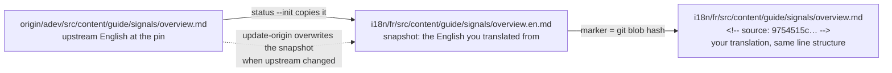
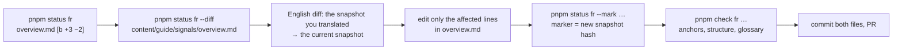

# Translating a page

You need Git, Node 26 (`.nvmrc`), pnpm, `pnpm install` at the repo root and `pnpm bootstrap` once (it fetches the pinned upstream commit into `origin/`, shallow: `status`, `check` and `--init` read the English from there). You do **not** need the Angular build to translate; `pnpm check` validates a page in a second, and the site build runs in CI.

## Files and markers

For every translated file there are two files side by side:

| File | Content |
| --- | --- |
| `i18n/<lang>/src/content/guide/signals/overview.en.md` | The English page exactly as it was in upstream when you translated it (the *snapshot*). Refreshed by `pnpm update-origin`; never edit it by hand. |
| `i18n/<lang>/src/content/guide/signals/overview.md` | Your translation. First line: `<!-- source: <hash> -->`, the git blob hash of the snapshot (`git hash-object overview.en.md`). |

Same scheme for app templates (`.html` + `.en.html`, same marker) and TypeScript overlays (`.ts` + `.en.ts`, marker `// source: <hash>`). JSON files cannot carry a comment, so their marker lives in a sidecar: `versions.json` + `versions.en.json` + `versions.json.source`; `pnpm status --init` and `--mark` write it for you.

Why both: the snapshot gives everyone the exact English you worked from, so the next sync can show a readable diff; the hash tells the tooling whether your translation still matches the current snapshot.



## New page

```bash
pnpm status fr                                        # lists untranslated pages under "untranslated"
pnpm status fr --init content/guide/signals/overview.md   # copies the snapshot and a to-translate copy with the marker
```

Translate `overview.md` in place, keeping the line structure. Then `pnpm check fr i18n/fr/src/content/guide/signals/overview.md`.

## Outdated page

```bash
pnpm status fr                                  # "outdated" lists pages whose snapshot changed, with a diff class
pnpm status fr --diff content/guide/signals/overview.md   # the English diff since your translation
```



Diff classes (borrowed from angular-ja): **a** code, link targets, URLs or whitespace only; **b** up to 5 changed prose lines; **c** up to 30; **d** restructure. Class a needs no translator: `pnpm status fr --apply-mechanical <path>` (or `all`) swaps the changed code lines and link targets into the translation and updates the marker. For b and c, rewrite only the affected passages, keep everything else byte-identical, set the marker to the new snapshot hash (`pnpm status fr --mark <path>`), then run `pnpm check` (it reports the page as outdated until the marker is current). d is usually a whole-page retranslation.

## Rules the checker enforces

- Same number of lines as the snapshot (the marker line excepted) when `lineParity: strict`.
- Same headings, in the same order; every translated heading keeps the English anchor: `## Composants {#components}`. The anchor is computed with upstream's rule (lowercase, spaces and slashes to dashes, keep letters, digits and dashes) unless the English heading already has a `{#custom-id}`, which you keep. `docs-step` titles are headings too: `<docs-step title="Créer un composant {#create-a-component}">` (the `{#…}` is hidden on the page).
- Same `docs-*` elements and attributes (`docs-callout`, `docs-card`, `docs-step`, `docs-tab`, `docs-code`, `docs-pill`, `docs-workflow`…), same code blocks, same link targets. Translate titles, labels and alt text; never translate `path`, `region`, `visibleLines`, `highlight`, URLs, identifiers.
- Code blocks and `docs-code` snippets stay in English, comments included (v1 rule; see `LANGUAGE.md` if your language decided otherwise).
- Alerts keep their keyword: a paragraph starting with `NOTE: `, `TIP: `, `HELPFUL: `, `IMPORTANT: `, `CRITICAL: `, `QUESTION: `, `SUMMARY: `, `TLDR: ` or `TODO: ` is syntax for the docs pipeline. Translate the sentence after it, never the keyword or its plain colon (`NOTE: Les signals…`, not `REMARQUE : …`): the label readers see ("Note :", "Astuce :") comes from `dictionaries/pipeline.json`. The checker counts alerts per keyword against the snapshot.
- Glossary: forbidden renderings are errors (found by textlint with the rules `pnpm glossary` generates into `prh.yml`; an editor with a textlint extension shows them as you type), missing `keep` terms are warnings.
- Typography from `LANGUAGE.md`: quotes, spacing before punctuation, heading case (warnings; prose only, so code, tags, alert keywords and any line left identical to the English are skipped).

## Deferring part of a page

When a page changed a lot and you cannot finish it, keep the new English section in place, untranslated, so the page is complete, and list it under "Untranslated or deferred" in your PR. Lines left identical to the English raise no typography warning. The status page shows the page as outdated until a later PR finishes it.

## Dictionaries

Strings outside Markdown live in `i18n/<lang>/dictionaries/`: `navigation.json` (menu labels), `ui.json` (visible strings of the app and of the shared docs components: search dialog, table of contents, cookie banner, example viewer…), `index-html.json` (the HTML shell's `lang`, title, description and URLs) and `pipeline.json` (what the docs pipeline bakes into every page: alert labels, "Learn more" on cards, the edit-page tooltip, prefer/avoid headers). In the two JSON maps, translate values and never keys; in the two pair lists, never touch `find` and translate only the quoted English inside `replace`, keeping every quote, comma and `${` (`"NOTE = 'NOTE',"` → `"NOTE = 'Note\u202f',"` gives the French label with its narrow no-break space). `pnpm dictionaries <lang>` adds new upstream strings (English values) and `pnpm status` lists them; `pnpm check` fails on a pair whose `find` no longer matches upstream.

## Pull request

One PR per page or small group. The template asks for: pages translated, pages deferred, anything moved or removed, and the `pnpm check` output. Reviewers see `.en.md` and `.md` diffs side by side.

## With an AI assistant

Open the repo in Claude Code, Gemini CLI or another skills-aware agent and ask it to "translate `content/guide/signals/overview.md` into fr" or "update the outdated pages of class a and b". The `adev-translation` skill applies exactly the rules above and runs `pnpm check`. Read the result as a reviewer would: you sign the PR.
